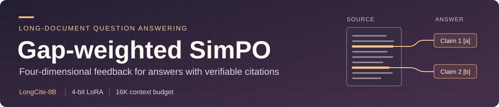
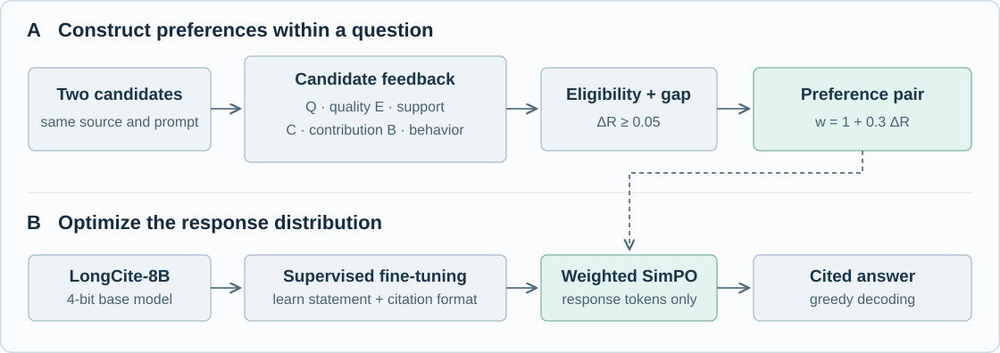

<div align="center">



**面向可核验长文档问答的四维反馈与加权偏好优化**

[方法设计](#方法设计) · [评价指标](#评价指标) · [快速开始](#快速开始) · [代码导航](#代码导航)

</div>

长文档问答里，引用找对了段落，答案仍可能答错。例如，一份报告在同一段里列出预算和实际支出，模型即使引用了这段原文，也可能把预算写成支出。本项目让模型在生成声明时一并给出出处，并在偏好训练中分别考察回答是否解决了问题，以及所引文字是否支持它给出的答案。

## 方法设计



四项反馈各回答一个问题。自然问答启用前三项并按有效权重归一化，带有明确证据条件的诊断样例才启用 B。

| 反馈 | 判定依据 | 基础权重 |
| --- | --- | ---: |
| **Q**　答案质量 | 是否答全所问，实体、事实与数量是否准确 | 0.40 |
| **E**　证据支持 | 每条声明能否从它所引用的句段中得到支持 | 0.20 |
| **C**　引用贡献 | 固定声明与生成历史后，只保留引文和移除引文会怎样改变声明的对数概率 | 0.30 |
| **B**　证据行为 | 证据充分、不足或冲突时，模型能否相应作答、保留判断或说明冲突 | 0.10 |

短程监督微调先教会模型如何组织声明与引文。随后，同一道题的两个候选按综合奖励排序。优选回答须通过内容与证据门槛，两侧均须有可信标注。奖励差达到 0.05 的候选对进入 SimPO，其损失权重为 $w_i=1+0.3\,\Delta R_i$。每个梯度累积窗口按权重总和归一化，使差异更清楚的一对回答在这次更新中占更大比重。[偏好对构造](grounded_qa/feedback/preferences.py) · [加权目标](grounded_qa/training/weighted_simpo.py)

## 评价指标

| 观察对象 | 指标 | 汇总单位 |
| --- | --- | --- |
| 回答是否切题 | 答案正确性 | 对具有有效语义评分的问题取均值 |
| 声明与引文能否解析 | 引用合法率 | 逐回答检查原始标签和句段范围 |
| 引用是否准确、充分 | 引用 Precision、Recall、F1 | 每题先算 F1，再分别汇总三项指标 |
| 阅读引文需要多少上下文 | 平均引用长度 | 统一分词器，对每个非空引文按 token 计数 |

汇总函数同时返回各指标的有效覆盖数。固定题评估使用了参考答案监督，结果用于描述该设置下的拟合。定向干预在同一适配器上改变指定维度的监督目标，用于观察模型对不同训练信号的响应。[评分实现](grounded_qa/evaluation/)

## 快速开始

在仓库根目录可以直接查看九个阶段的命令和参数。查看帮助只需 Python。

```bash
python -m grounded_qa --help
python -m grounded_qa simpo --help
```

<details>
<summary><strong>运行训练与推理</strong>　环境、数据与命令</summary>

在 Linux CUDA 环境中先安装与驱动匹配的 PyTorch 2.5 系列，再安装 `requirements.txt`。把上游 `longcite_modeling_llama.py` 的目录加入 `PYTHONPATH`。`MODEL` 和 `TOKENIZER` 用来指定本地基础模型和分词器。基础模型固定在版本 `4dcf5f007780563aebc54b0199ae269aaec7af4b`。[模型权重与分词器](https://huggingface.co/THUDM/LongCite-llama3.1-8b/tree/4dcf5f007780563aebc54b0199ae269aaec7af4b) · [上游模型实现](https://github.com/facebookresearch/SelfCite)

```bash
python -m pip install -r requirements.txt
export PYTHONPATH="/path/to/SelfCite${PYTHONPATH:+:$PYTHONPATH}"
export MODEL=/path/to/longcite-base
export TOKENIZER=/path/to/longcite-tokenizer

python -m grounded_qa prompt --input questions.jsonl --out prompts.jsonl
python -m grounded_qa trace --model "$MODEL" --tokenizer "$TOKENIZER" --input candidates.jsonl --out traced.jsonl
python -m grounded_qa pairs --input traced.jsonl --out pairs.jsonl
python -m grounded_qa sft --model "$MODEL" --tokenizer "$TOKENIZER" --input demonstrations.jsonl --lr 1e-5 --out adapters/sft
python -m grounded_qa simpo --model "$MODEL" --tokenizer "$TOKENIZER" --adapter adapters/sft --input pairs.jsonl --lr 3e-6 --out adapters/simpo
python -m grounded_qa predict --model "$MODEL" --tokenizer "$TOKENIZER" --adapter adapters/simpo --input prompts.jsonl --out predictions.jsonl
```

输入均为 UTF-8 JSONL。问题记录包含 `id`、`dataset`、`context` 和 `query`。SFT 读取 `prompt` 和 `response`。准备候选时，在同一提示记录下添加两个 `candidates`，每侧提供 `response`、`Q`、`E`、`confidence`、`critical_error` 和逐声明数组 `statement_support`。`trace` 补充三种证据条件下的概率，`pairs` 输出通过门槛的偏好对。定向干预读取含 `id`、`axis`、`prompt`、`preferred`、`weakened` 的记录，用 `intervene --axis E` 等命令生成该分支的 SFT 目标。

训练在查询和值投影上使用秩 16、缩放 32 的 LoRA，dropout 为 0.05。推理按声明边界停止，问答与摘要的长度设置见[解码配置](configs/decoding.json)。

</details>

<details>
<summary><strong>运行评测</strong>　语义裁判与离线汇总</summary>

`judge` 加载上游的 `auto_scorer.py` 与 `eval_correct.py`。将参考答案列表放在记录的 `answer` 字段，并提供对应数据集的评分字段。通过 `module:factory` 指定自己的裁判传输实现。工厂返回带 `query` 方法的对象，兼容上游请求参数，按需返回文本和 token 用量。`metrics` 读取已经得到的评分，离线计算指标与覆盖数。[上游评价代码](https://github.com/THUDM/LongCite)

```bash
python -m grounded_qa judge --input predictions.jsonl --scorer-dir /path/to/LongCite/LongBench-Cite --transport my_judge:make_client --judge-model "$JUDGE_MODEL" --out scores.jsonl
python -m grounded_qa metrics --input predictions.jsonl --scores scores.jsonl --tokenizer "$TOKENIZER" --out metrics.json
```

</details>

## 代码导航

| 目录 | 从这里读什么 |
| --- | --- |
| [`grounded_qa/data/`](grounded_qa/data/) | 文档提示、声明解析、引用范围和 JSONL 读写 |
| [`grounded_qa/feedback/`](grounded_qa/feedback/) | 完整、保留、移除三种证据上下文的打分与偏好对构造 |
| [`grounded_qa/training/`](grounded_qa/training/) | SFT 训练、SimPO 梯度重放、按窗口归一化的损失 |
| [`grounded_qa/inference/`](grounded_qa/inference/) | 贪心生成、重复约束与完整声明停止条件 |
| [`grounded_qa/evaluation/`](grounded_qa/evaluation/) | 上游语义评分与六项指标聚合 |
| [`configs/`](configs/) | 问答与摘要共用的解码策略配置 |
| [`tests/`](tests/) | 命令行入口、模块导入和配置定位的回归检查 |

共享的模型加载与回答 token 损失位于 [`backbone.py`](grounded_qa/backbone.py)。偏好优化的基础目标见 [SimPO 原论文](https://arxiv.org/abs/2405.14734)。
